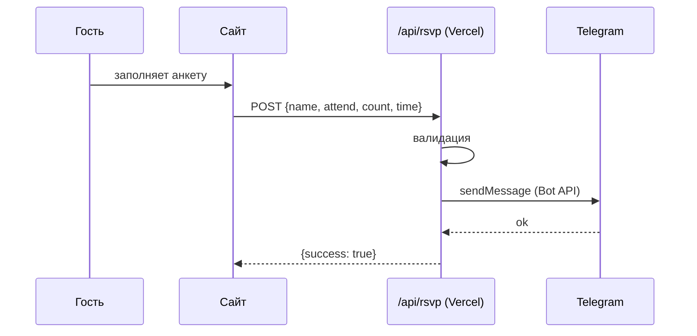

<div align="center">

# 💍 Той шақыру v2 — свадебное приглашение с фото

**Сайт-приглашение на казахскую свадьбу (той): таймер обратного отсчёта, музыка и анкета гостя, ответы на которую приходят в Telegram**

[](https://wedding2-gray.vercel.app)


</div>

---

> Расширенная версия [**wedding**](https://github.com/Denryy/wedding): добавлены фотосекции и автоскролл.

## ✨ Что есть на странице

- 📸 **Фото-обложка** и фотосекции между блоками (пара, календарь, зал, сервировка)
- 🌸 **Обложка** с именами молодожёнов и датой
- 💌 **Текст приглашения** и блок родителей (той иелері)
- 📅 **Дата и время** + ⏳ **обратный отсчёт** (дни / часы / минуты / секунды)
- 📍 **Место проведения** с кнопкой «открыть в 2GIS»
- 📝 **RSVP-анкета**: имя, «приду / придём вдвоём / не смогу», количество гостей
- 🎵 **Фоновая музыка** с кнопкой включения
- 🪄 **Плавное появление секций** при прокрутке (IntersectionObserver)
- 🎞️ **Автоскролл**: страница сама плавно листается, пауза на 3 секунды после касания или прокрутки

Весь интерфейс на казахском языке. Фреймворков нет: чистые HTML, CSS и JS.

## 📩 Как работает RSVP



Токен бота хранится **только на сервере** в переменных окружения, во фронтенд он не попадает. Копия ответа дополнительно сохраняется в `localStorage` браузера гостя.

## 🎨 Настройка под свою свадьбу

Всё содержимое (имена, дата, тексты, родители, место, варианты ответа, музыка, цвета) меняется в **одном объекте `CONFIG`** в начале `script.js`. Остальной код трогать не нужно.

```js
const CONFIG = {
  hero:   { groomName: "...", brideName: "...", date: "..." },
  event:  { /* дата для таймера: "YYYY-MM-DDTHH:MM:SS" */ },
  venue:  { /* название, адрес, ссылка на 2GIS */ },
  music:  { src: "./assets/....mp3" },
  theme:  { "--color-primary": "#b08d57", /* ... */ },
};
```

## 🚀 Запуск и деплой

1. Создай бота у [@BotFather](https://t.me/BotFather) и узнай `CHAT_ID` чата, куда будут приходить ответы.
2. Задай переменные окружения:

   ```env
   BOT_TOKEN=123456:ABC...
   CHAT_ID=123456789
   ```

   Локально положи их в файл `.env` (не коммить его!). На Vercel: **Settings → Environment Variables**.
3. Запуск локально:

   ```bash
   npm install
   npm run dev      # vercel dev → http://localhost:3000
   ```

4. Деплой: `npx vercel --prod` или подключи репозиторий в Vercel.

## 🗂️ Структура

```text
index.html     # разметка секций
style.css      # стили (шрифты Cormorant Garamond, Playfair Display, EB Garamond)
script.js      # CONFIG + рендер, таймер, музыка, анимации, RSVP
api/rsvp.js    # serverless-функция → Telegram Bot API
assets/        # музыка и фотографии
```

---

<div align="center">
  <sub>Автор: <a href="https://github.com/Denryy">Arman Zhetessov</a></sub>
</div>
